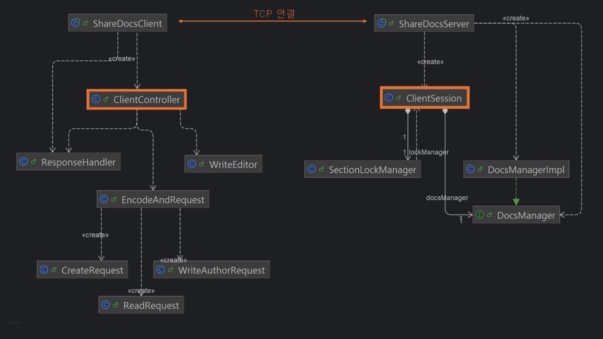

# ShareDocs 설계보고서

**2분반 C111077 배성우**

## 개요

ShareDocs는 클라이언트-서버 구조의 공유 문서 편집 시스템입니다.

### 시스템 구조

<div align="center">
  
</div>

- **클라이언트 측**: 사용자 입력을 제어하는 `ClientController`를 중심으로 클라이언트의 요청(`EncodeAndRequest`)과 응답 처리(`ResponseHandler`)를 담당하며, 특히 문서 작성 시 `WriteEditor`를 통해 편리한 GUI를 제공합니다.
- **서버 측**: 클라이언트마다 분기된 `ClientSession` 쓰레드가 문서 생성/읽기/쓰기 처리를 수행합니다. 특히 `SectionLockManager`는 공유 문서 섹션의 배타적 쓰기 처리를 위한 역할을 합니다.

## 통신 프로토콜

### 요청 형식

클라이언트는 `EncodeAndRequest` 클래스를 통해 서버로 전송할 명령 요청을 JSON 형식의 문자열로 직렬화하여 전송합니다. 이는 Google의 Gson 라이브러리를 활용했습니다.

#### Create 요청

```json
{
  "command": "create",
  "docTitle": "소켓 프로그래밍",
  "sectionCount": 3,
  "sectionTitles": ["BSD Unix 개요", "TCP 소켓", "UDP 소켓"]
}
```

#### Read 요청

특정 섹션을 지정하여 읽을 때:

```json
{
  "command": "read",
  "docTitle": "블록체인",
  "sectionTitle": "탈중앙화"
}
```

문서 구조만을 요청할 경우:

```json
{
  "command": "read"
}
```

#### Write 요청

쓰기 권한을 요청할 때:

```json
{
  "command": "write",
  "docTitle": "블록체인",
  "sectionTitle": "탈중앙화"
}
```

> **참고**: 서버의 권한 승인 통보를 받고 나서는 JSON 형식을 사용하지 않습니다. 즉, 사용자의 키보드 입력을 줄 단위의 일반 텍스트로 서버에 전송합니다.

#### Bye 요청

```json
{
  "command": "bye"
}
```

### 응답 형식

클라이언트는 서버의 응답을 파싱하여 그 의미를 정확히 해석해야 하므로, 응답의 종류(`ok`, `wait`, `error`)를 명확히 구분할 수 있는 기준이 필요합니다.

**통신 규약**: 모든 응답 메시지의 첫 줄을 반드시 `status: `로 시작하고, 이후 일반 텍스트 형식의 줄 단위 응답을 순차적으로 이어서 전송합니다.

이러한 규약을 통해:
- 서버는 클라이언트에게 항상 줄 단위의 응답을 제공할 수 있습니다.
- 클라이언트는 첫 줄의 `status` 값을 기준으로 후속 동작을 결정합니다.

## 기능 상세

### 1. 문서 생성 (Create)

문서 생성 요청이 서버에 도착하면, 서버는 클라이언트가 지정한 문서 제목과 섹션 제목 리스트를 기반으로 공유 문서 디렉토리 내에 파일을 생성합니다.

- 각 섹션은 `<prefix>. <sectionTitle>.txt` 형식의 파일로 저장됩니다.
- 공유 문서는 루트 디렉토리(`shared_docs`) 하위에 `<docTitle>` 디렉토리로 관리됩니다.

**예시**: `shared_docs/소켓 프로그래밍/2. TCP 소켓.txt`

> 섹션 파일명에 prefix를 포함하는 이유는, create 명령 실행 시 클라이언트가 전달한 섹션 순서를 정확히 보존하기 위함입니다.

### 2. 문서 읽기 (Read)

#### 문서 구조 조회

전달 인자(`docTitle`과 `sectionTitle`)가 없는 경우, 서버는 `shared_docs` 아래의 모든 공유 문서 제목 및 섹션 제목 정보를 클라이언트에게 전송합니다.

- 공유 문서와 해당 문서의 섹션 제목이 끝날 때마다 `__SEP__` 구분자를 삽입합니다.
- 전체 데이터 전송의 끝에는 `__END__` 종료자를 추가하여 종료를 명시합니다.

#### 특정 섹션 읽기

전달 인자가 있는 경우, 서버는 요청받은 공유 문서의 제목과 섹션 제목, 해당 내용을 클라이언트에게 전송합니다.

- 전체 데이터 전송의 끝에 `__END__`를 추가합니다.

### 3. 문서 쓰기 (Write)

#### 쓰기 권한 요청 및 관리

클라이언트가 write 명령을 통해 특정 문서의 섹션에 대한 쓰기 권한을 요청하면, 서버는 해당 섹션에 대한 배타적 쓰기 권한을 부여할 수 있는지를 판단합니다. 이 처리는 `SectionLockManager`를 통해 이루어지며, 각 섹션마다 다음과 같은 필드를 갖습니다:

```java
class Section {
    ClientSession currentWriter = null;
    final Queue<ClientSession> waitingQueue = new ConcurrentLinkedQueue<>();
    final ReentrantLock lock = new ReentrantLock(true);
    final Condition condition = lock.newCondition();
}
```

#### 쓰기 권한 부여 프로세스

1. 서버는 `clientSession` 쓰레드 객체를 우선 섹션의 `waitingQueue`에 추가합니다.
2. 해당 쓰레드는 섹션 `lock`을 획득하고, 자신이 대기열 맨 앞이면서 `currentWriter` 자리가 빌 때까지 기다립니다.
   ```java
   while (section.waitingQueue.peek() != requester || section.currentWriter != null)
   ```
3. 대기 중에는 클라이언트에게 처음 한 번만 `status: wait` 응답을 전송하며, 이후에는 `condition.await()`을 호출하여 busy-wait 없이 효율적으로 차례를 기다립니다.
4. 조건이 충족되면, 서버는 대기열에서 다음 순서의 쓰레드를 꺼내어 `currentWriter`에 할당하고, 해당하는 클라이언트에게 `status: ok`를 전송합니다.

#### 텍스트 입력 및 전송

쓰기 권한을 부여받은 클라이언트는 Java Swing 기반 GUI 입력창인 `WriteEditor`를 통해 사용자로부터 텍스트를 자유롭게 입력 받습니다.

- 최종적으로 OK 버튼을 누르면 내부적으로 `splitLinesWithLimit()` 메서드를 통해 각 줄을 UTF-8 기준 64바이트 이내로 자동 분할합니다.
- 이 과정을 통해 클라이언트는 최대 10줄의 유효한 문자열 리스트를 생성하고, 이를 줄 단위로 서버에 전송하며 마지막에 `__END__` 종료자를 추가합니다.

> **참고**: OK 버튼 클릭에는 사용자의 입력에 `__END__` 문자열이 포함되었는지 검사하는 기능도 포함됩니다.

#### 쓰기 작업 완료 처리

쓰기 작업이 완료되면:

1. 서버는 `currentWriter`를 `null`로 초기화합니다.
2. `condition.signalAll()`을 호출하여 대기 중인 모든 쓰레드를 깨웁니다.
3. 깨어난 쓰레드들 중, 대기열 선두에 있는 단 하나의 쓰레드만이 다음 쓰기 권한을 획득하게 됩니다.

## 동시성 제어

ShareDocs는 모든 쓰기 요청이 **FIFO 방식**으로 처리됨을 반드시 보장합니다.

다음과 같은 메커니즘을 통해 다수 클라이언트 환경에서도 안정적이고 일관된 동작을 유지합니다:

- **ConcurrentLinkedQueue**를 활용한 대기열 기반의 엄격한 조건 검사
- **ReentrantLock** 기반의 공정성 설정(`true`)
- **Condition**을 이용한 효율적인 wait-awake 메커니즘
